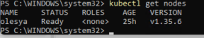
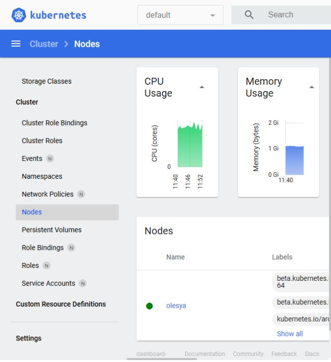

# Домашнее задание: Kubernetes и kubectl

## Задание 1. Установка MicroK8s

MicroK8s установлен на сервере локальном сервере "192.168.1.152". Проверка состояния:

```
microk8s status
```

Команда показала:  "microk8s is running".

Команда, которая в задании, не сработало. Не был включен dashboard.
Включаем дашборд:

```
microk8s enable dashboard
```

Установка также включила Metrics Server. Dashboard развёрнут в пространстве имён kubernetes-dashboard. Проверка:

```
microk8s kubectl get pods,svc -n kubernetes-dashboard
```

Все пять подов показываю статус Running и готовность 1/1. Служа для подключения работает на порту 443.
Сертификаты сервера уже содержал локальный ip 192.168.1.152.
Это можно проверить командой:

```
openssl x509 -in /var/snap/microk8s/current/certs/server.crt -noout -ext subjectAltName
```

## Задание 2. Локальный kubectl и Dashboard

Локальный kubectl на Windows подключён к кластеру. Проверяем:

```powershell
kubectl get nodes
```

```text
NAME     STATUS   ROLES    AGE   VERSION
olesya   Ready    <none>   25h   v1.35.6
```



Подключение через локальный ip 192.168.1.152:16443 прошло с проверкой сертификата API сервера по данным kubeconfig. Содержимое в репозиторий не добавляется т.к. содержит личные данные.
Чтобы попасть в Dashboard нужно открыть ссылку: https://localhost:10443.
После входа на странице nodes виден узел "olesya"



